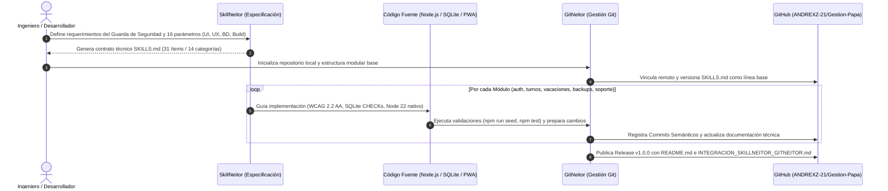

# 🔗 Documento Técnico de Relación e Integración: SkillNeitor + GitNeitor

**Proyecto:** Gestión Trabajo Papá (`gestion-trabajo-papa`)  
**Repositorio Oficial:** [https://github.com/ANDREXZ-21/Gestion-Papa](https://github.com/ANDREXZ-21/Gestion-Papa)  
**Stack Tecnológico:** Node.js `>=22.0.0` (HTTP Nativo + `node:sqlite`), SQLite Transaccional, Frontend PWA (HTML5, CSS3, JavaScript ES6+, Service Worker)  
**Artefactos Vinculados:** [`SKILLS.md`](./SKILLS.md) · [`README.md`](./README.md) · [`package.json`](./package.json)

---

## 1. Resumen Ejecutivo

En la ingeniería de software moderna asistida por IA y flujos DevOps, existe una brecha frecuente entre **lo que se especifica en el diseño técnico** y **lo que realmente se construye, versiona y documenta en el repositorio**. 

Para eliminar esa brecha en el desarrollo de **Gestión Trabajo Papá**, se implementó un flujo de trabajo dual basado en dos herramientas complementarias:

1. **SkillNeitor (Ingeniería de Especificación y Gobernanza Técnica):** Actúa en la fase de *Diseño y Definición*. Establece las reglas de arquitectura, los criterios de aceptación y los **16 parámetros rectores** divididos en cuatro dominios críticos: **Interfaz de Usuario (UI), Experiencia de Usuario (UX), Base de Datos (BD) y Compilación/Ejecución (Build & Runtime)**, materializados en el archivo [`SKILLS.md`](./SKILLS.md).
2. **GitNeitor (Gestión de Ciclo de Vida, Control de Versiones y Documentación en GitHub):** Actúa en la fase de *Ejecución, Trazabilidad y Entrega*. Traduce las reglas de SkillNeitor en una estructura de repositorio limpia, convenciones de commits semánticos, estrategia de ramas, control de cambios y documentación viva en GitHub ([`README.md`](./README.md)).

> **Síntesis de la sinergia:** *SkillNeitor define el **"Qué y bajo qué estándares de calidad"** se construye la aplicación, mientras que GitNeitor garantiza el **"Cómo se versiona, audita, documenta y despliega"** cada uno de esos estándares en GitHub.*

---

## 2. Rol Técnico de Cada Herramienta en el Proyecto

### 2.1. Rol de SkillNeitor: El Contrato de Arquitectura y los 16 Parámetros
**SkillNeitor** fue utilizado para transformar la necesidad operativa de un guarda de seguridad privada (registro de turnos 12h diurnos/nocturnos, cálculo de descansos compensatorios/dominicales y control de vacaciones) en una especificación técnica ejecutable ([`SKILLS.md`](./SKILLS.md)).

Su función principal fue acotar el alcance y parametrizar **16 lineamientos técnicos obligatorios** agrupados en 4 pilares (4 parámetros por pilar):

- **Pilar 1 — Interfaz de Usuario (UI):**
  1. *Tokens de Diseño y Consistencia Visual:* Variables CSS centralizadas en `public/styles.css`.
  2. *Contraste y Semántica Visual (WCAG 2.2 AA):* Contraste mínimo `4.5:1` y diferenciación visual de estados de turno (Diurno, Nocturno, Relevo, Compensatorio, Vacaciones).
  3. *Diseño Responsivo y Adaptativo:* Soporte comprobado en `320px`, `768px`, `1024px` y zoom al `200%`.
  4. *Objetivos Táctiles (Touch Targets):* Áreas interactivas mínimas de `24x24 px` / `44x44 px` para uso cómodo en teléfonos móviles durante turnos de vigilancia.
- **Pilar 2 — Experiencia de Usuario (UX):**
  5. *Accesibilidad por Teclado y Foco:* Navegación completa sin ratón, orden de tabulación lógico y control de foco en modales (`public/index.html`, `public/app.js`).
  6. *Formularios y Validación UX sin Fricción:* Validación clara al enviar o salir del campo, preservando siempre los datos ingresados por el usuario.
  7. *Microcopy Claro y Estados Vacíos con Acción:* Mensajes en español directo orientados a la tarea del guarda de seguridad, evitando tecnicismos ambiguos.
  8. *Experiencia PWA e Instalación Offline-First:* Manifiesto web (`public/manifest.webmanifest`) y Service Worker (`public/sw.js`) para acceso rápido desde el móvil.
- **Pilar 3 — Base de Datos y Persistencia (BD):**
  9. *Integridad Referencial y Restricciones Declarativas:* `PRAGMA foreign_keys = ON`, llaves foráneas en cascada y validaciones `CHECK` / `UNIQUE(user_id, shift_date)` en `src/shared/database.js`.
  10. *Migraciones de Esquema y Control de Concurrencia:* Tabla `schema_migrations`, trazabilidad (`created_at`, `updated_at`, `updated_by`) y columna `version` para bloqueo optimista.
  11. *Indexación Orientada a Consultas:* Índices compuestos sobre fechas de turnos, tipos de jornada, periodos de vacaciones y expiración de sesiones.
  12. *Semillas Reproducibles y Copias de Seguridad:* Carga determinista de datos de prueba (`src/shared/seed.js`) y motor de respaldos bajo demanda (`src/shared/cli-backup.js` y `src/modules/backups/index.js`).
- **Pilar 4 — Compilación, Ejecución y Entrega (Build & Runtime):**
  13. *Ejecución Nativa Zero-Dependencies (Node.js >= 22):* Uso de `node:http`, `node:sqlite`, `node:crypto` y `node:test`, eliminando transpiladores complejos y dependencias vulnerables.
  14. *Externalización de Configuración (`.env`):* Gestión segura de variables de entorno en `src/shared/config.js` con plantilla `.env.example`.
  15. *Scripts Automatizados de Ciclo de Vida:* Comandos declarativos en `package.json` (`start`, `dev`, `test`, `seed`, `backup`).
  16. *Seguridad HTTP y Empaquetado Estático:* Cabeceras de protección en `src/shared/security.js` y versionado de activos estáticos en el Service Worker.

---

### 2.2. Rol de GitNeitor: Trazabilidad, Versionado y Documentación en GitHub
Una vez establecida la especificación con SkillNeitor, **GitNeitor** asumió el control del flujo de ingeniería en el repositorio local y remoto (`https://github.com/ANDREXZ-21/Gestion-Papa`):

1. **Estandarización del Árbol del Repositorio:** Garantizó que la arquitectura de Monolito Modular definida en SkillNeitor se reflejara fielmente en las carpetas `src/modules/`, `src/shared/` y `public/`, excluyendo artefactos volátiles mediante `.gitignore`.
2. **Trazabilidad de Commits y Ramas:** Vinculó cada cambio de código con un dominio técnico específico (UI, UX, BD o Compilación), asegurando que ningún cambio llegara a la rama `main` sin cumplir los criterios de aceptación de `SKILLS.md`.
3. **Automatización Documental:** Estructuró el archivo `README.md` y el presente documento de integración para que cualquier evaluador, desarrollador o auditor técnico pueda comprender la arquitectura, instalar el entorno en minutos y verificar el cumplimiento de los 16 parámetros.

---

## 3. Flujo de Trabajo Integrado: "De la Especificación al Repositorio"

El siguiente diagrama ilustra cómo interactúan **SkillNeitor** y **GitNeitor** de principio a fin durante el ciclo de desarrollo de **Gestión Trabajo Papá**:

### Etapas Detalladas de la Integración

1. **Etapa 1 — Parametrización en SkillNeitor y Línea Base en GitNeitor:**
   - Se genera `SKILLS.md` con SkillNeitor 1.2.0 estableciendo las reglas de negocio (patrones `2x2x2`, `6x1`, cálculo de festivos y vacaciones) y los 16 parámetros técnicos.
   - GitNeitor registra `SKILLS.md` en la raíz del proyecto como la "fuente única de verdad" (*Single Source of Truth*).
2. **Etapa 2 — Implementación Guiada por Parámetros (BD y Compilación):**
   - Siguiendo los parámetros 9 al 16 de SkillNeitor, se construyen `src/shared/config.js`, `src/shared/database.js`, `src/shared/security.js` y `package.json`.
   - GitNeitor protege los archivos `.sqlite` y `.env` mediante `.gitignore` y versiona únicamente el esquema declarativo (`SCHEMA_SQL`), la plantilla `.env.example` y los scripts reproducibles (`seed.js`, `cli-backup.js`).
3. **Etapa 3 — Implementación de Dominios y Capa Visual (UI y UX):**
   - Siguiendo los parámetros 1 al 8 de SkillNeitor, se codifican los módulos backend (`auth`, `turnos`, `vacaciones`, `backups`, `soporte`) y la interfaz PWA (`public/index.html`, `public/styles.css`, `public/app.js`, `public/sw.js`).
   - GitNeitor organiza los incrementos funcionales y verifica que cada vista cumpla con accesibilidad, validación UX y diseño responsivo antes de consolidar en la rama `main`.
4. **Etapa 4 — Cierre Documental y Publicación en GitHub:**
   - GitNeitor consolida la documentación final en `README.md` e `INTEGRACION_SKILLNEITOR_GITNEITOR.md`, sincronizando el historial completo en `https://github.com/ANDREXZ-21/Gestion-Papa`.

---

## 4. Matriz de Trazabilidad: Los 16 Parámetros (SkillNeitor ↔ Código ↔ GitNeitor en GitHub)

La siguiente matriz demuestra de forma auditable cómo cada uno de los **16 parámetros definidos en SkillNeitor** se transformó en código real dentro del proyecto y cómo **GitNeitor** lo gestionó y documentó en GitHub:

| # | Área | Parámetro Definido en SkillNeitor (`SKILLS.md`) | Implementación Técnica en el Proyecto (`Gestion-Papa`) | Gestión, Evidencia y Artefacto en GitHub (`GitNeitor`) |
| :-: | :--- | :--- | :--- | :--- |
| **01** | **UI** | **Tokens de Diseño y Jerarquía Visual** | Variables CSS globales, paleta de alto contraste y tipografía legible en [`public/styles.css`](./public/styles.css). | Versionado en `public/styles.css` bajo control de cambios de interfaz (`feat(ui)`). |
| **02** | **UI** | **Contraste WCAG 2.2 AA (`4.5:1` / `3:1`)** | Colores diferenciados + etiquetas textuales para turnos (`diurno`, `nocturno`, `relevo`, `compensatorio`, `vacaciones`). | Criterio de aceptación documentado en `SKILLS.md` y validado en revisiones de PR. |
| **03** | **UI** | **Diseño Responsivo (*Mobile-First*)** | Media queries y layouts flexibles/grid adaptados a `320px`, `768px`, `1024px` y zoom `200%` en [`public/styles.css`](./public/styles.css). | Verificación multi-resolución registrada en la guía de arquitectura del `README.md`. |
| **04** | **UI** | **Objetivos Táctiles Ampliados (`>=24x24px`)** | Botones de acción rápida y selectores de turno dimensionados para pantallas táctiles en [`public/index.html`](./public/index.html). | Trazabilidad directa con la restricción de usuario final (Guarda de Seguridad) en `SKILLS.md`. |
| **05** | **UX** | **Navegación por Teclado y Gestión de Foco** | HTML5 semántico, orden de tabulación lógico, regiones ARIA vivas y control de foco en [`public/index.html`](./public/index.html) y [`public/app.js`](./public/app.js). | Estándar auditado en la sección de UX/UI y Accesibilidad del repositorio. |
| **06** | **UX** | **Formularios y Validación UX sin Fricción** | Validación en cliente (`public/app.js`) y servidor (`src/modules/*`) con mensajes claros y conservación de datos en pantalla. | Commits incrementales vinculando validaciones frontend y respuestas HTTP 400 descriptivas. |
| **07** | **UX** | **Microcopy Claro y Estados Vacíos** | Textos orientados a vigilancia privada en español y estados vacíos con acción sugerida en [`public/app.js`](./public/app.js). | Lineamientos de *UX Writing* preservados en `SKILLS.md` y aplicados en las vistas. |
| **08** | **UX** | **Capacidad PWA y Soporte Offline** | Instalación móvil mediante [`public/manifest.webmanifest`](./public/manifest.webmanifest) y caché local en [`public/sw.js`](./public/sw.js). | Artefactos PWA versionados en la carpeta `public/` y etiquetados en `package.json`. |
| **09** | **BD** | **Integridad Referencial y Restricciones SQL** | `PRAGMA foreign_keys = ON`, `CHECK` constraints y `UNIQUE(user_id, shift_date)` en [`src/shared/database.js`](./src/shared/database.js). | Esquema SQL declarativo e idempotente (`CREATE TABLE IF NOT EXISTS`) bajo control de versiones. |
| **10** | **BD** | **Migraciones y Concurrencia Optimista** | Tabla `schema_migrations`, campos de auditoría (`created_at`, `updated_at`) y columna `version` en [`src/shared/database.js`](./src/shared/database.js). | Evolución segura del modelo de datos sin pérdida de información entre commits. |
| **11** | **BD** | **Indexación por Patrón de Acceso** | Índices `idx_shifts_user_date`, `idx_shifts_user_type`, `idx_vacations_user_start` y `idx_sessions_expires` en [`src/shared/database.js`](./src/shared/database.js). | Optimización documentada en la capa de persistencia del repositorio. |
| **12** | **BD** | **Semillas de Datos y Copias de Seguridad** | Script reproducible [`src/shared/seed.js`](./src/shared/seed.js), CLI [`src/shared/cli-backup.js`](./src/shared/cli-backup.js) y API [`src/modules/backups/index.js`](./src/modules/backups/index.js). | Exclusión de bases de datos vivas en `.gitignore` y versionado de scripts de recuperación. |
| **13** | **Compilación** | **Runtime Nativo *Zero-Dependencies*** | Uso exclusivo de Node.js `>=22.0.0` (`node:http`, `node:sqlite`, `node:crypto`) definido en `engines` de [`package.json`](./package.json). | Árbol del repositorio limpio sin dependencia de `node_modules` externos pesados. |
| **14** | **Compilación** | **Configuración por Variables de Entorno** | Centralización en [`src/shared/config.js`](./src/shared/config.js) y plantilla pública [`.env.example`](./.env.example). | Protección de secretos en `.gitignore` (`.env` excluido) y `.env.example` documentado en GitHub. |
| **15** | **Compilación** | **Automatización de Scripts NPM** | Scripts `start`, `dev` (`--watch`), `test` (`--test`), `seed` y `backup` en [`package.json`](./package.json). | Estandarización de comandos de integración y despliegue en el `README.md`. |
| **16** | **Compilación** | **Seguridad HTTP y Entrega Estática** | Cabeceras de seguridad, hashing de PIN y validación de sesiones en [`src/shared/security.js`](./src/shared/security.js) y [`src/app.js`](./src/app.js). | Versionado del núcleo de seguridad y servidor de activos en `src/shared/` y `src/app.js`. |

---

## 5. Comparativa Metodológica: Antes vs. Después de Integrar SkillNeitor + GitNeitor

| Criterio de Ingeniería | Desarrollo Tradicional (Sin Integración) | Desarrollo con SkillNeitor + GitNeitor (`Gestion-Papa`) |
| :--- | :--- | :--- |
| **Definición de Requerimientos** | Ideas dispersas o requisitos ambiguos sin criterios medibles. | Especificación formal en `SKILLS.md` con **16 parámetros verificables** (UI, UX, BD, Compilación). |
| **Estructura de Código** | Mezcla de lógica de base de datos, vistas e interfaz en archivos monolíticos difíciles de mantener. | **Monolito Modular** (`src/modules/`, `src/shared/`, `public/`) alineado desde el diseño hasta el repositorio. |
| **Control de Versiones en GitHub** | Commits genéricos sin contexto técnico y archivos sensibles o de base de datos subidos por error. | Flujo estructurado con **GitNeitor**, `.gitignore` estricto, convenciones semánticas y trazabilidad hacia `SKILLS.md`. |
| **Calidad de Base de Datos** | Tablas sin restricciones ni respaldos automatizados. | Motor SQLite con `FOREIGN KEYS`, `CHECK` constraints, índices compuestos, semillas (`npm run seed`) y backups (`npm run backup`). |
| **Documentación para Sustentación** | Documentación incompleta o redactada al final sin relación con el código real. | Documentación viva (`README.md` + `INTEGRACION_SKILLNEITOR_GITNEITOR.md` + `SKILLS.md`) 100% sincronizada con el repositorio. |

---

## 6. Conclusión Técnica

La integración de **SkillNeitor** y **GitNeitor** en el proyecto **Gestión Trabajo Papá** demuestra un flujo de ingeniería de software maduro, repetible y auditable:

1. **SkillNeitor** aportó el rigor arquitectónico previo a escribir código, asegurando que las necesidades reales de un guarda de seguridad privada se tradujeran en **16 parámetros técnicos concretos** de UI, UX, Base de Datos y Compilación.
2. **GitNeitor** convirtió esa especificación en un repositorio profesional en GitHub ([`ANDREXZ-21/Gestion-Papa`](https://github.com/ANDREXZ-21/Gestion-Papa)), manteniendo la trazabilidad entre cada módulo desarrollado (`auth`, `turnos`, `vacaciones`, `backups`, `soporte`), el historial de versiones y la documentación técnica lista para auditoría y sustentación.
