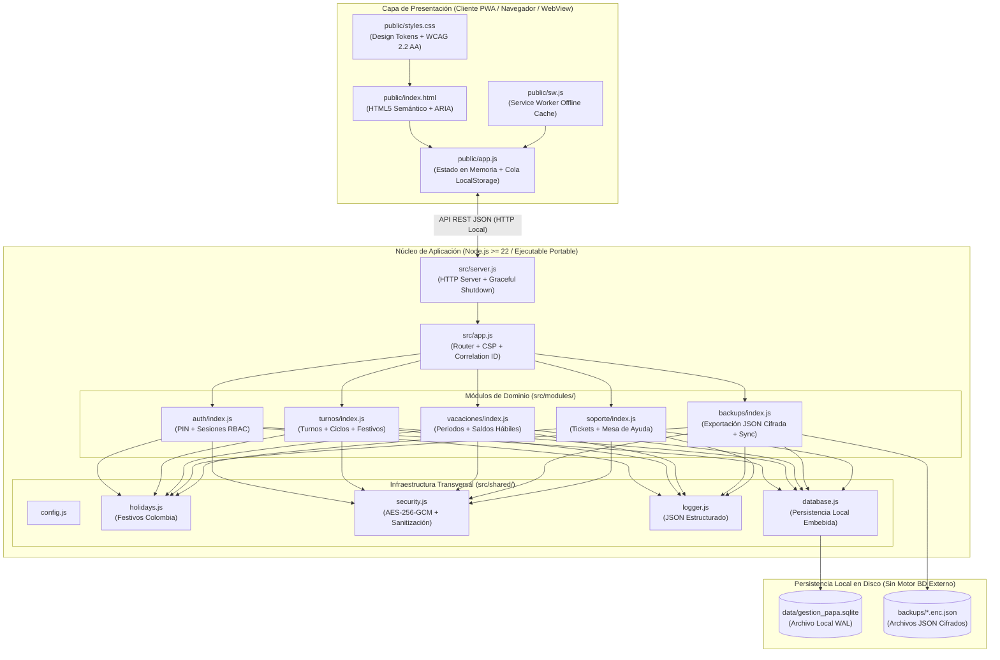

# 🛠️ MANUAL TÉCNICO DEL SISTEMA
## Proyecto: Gestión Trabajo Papá (`gestion-trabajo-papa`)

**Estándar de Referencia:** IEEE 830 / ISO/IEC/IEEE 26514  
**Versión:** 1.0.0  
**Repositorio Oficial:** [https://github.com/ANDREXZ-21/Gestion-Papa](https://github.com/ANDREXZ-21/Gestion-Papa)  
**Arquitectura:** Monolito Modular Autocontenido + Progressive Web App (PWA) / Ejecutable Portable Windows (`.exe`)  

---

## 1. Introducción y Alcance del Sistema

### 1.1. Propósito del Documento
El presente **Manual Técnico** describe la arquitectura interna, las decisiones de diseño UI/UX, los mecanismos de gestión de estado y persistencia local (sin servidores de bases de datos externos), los requerimientos técnicos y los controles de seguridad del sistema **Gestión Trabajo Papá**. Está dirigido a arquitectos de software, desarrolladores de mantenimiento y evaluadores técnicos.

### 1.2. Objetivo y Alcance del Software
**Gestión Trabajo Papá** resuelve la problemática del control manual y propenso a errores de las jornadas laborales en el sector de vigilancia y seguridad privada. Permite a guardas de seguridad y supervisores:
- Programar y registrar turnos de vigilancia (**Diurno 12h, Nocturno 12h, Relevos, Descansos Reglamentarios, Descansos Compensatorios, Permisos/Incapacidades y Vacaciones**).
- Generar ciclos automáticos de rotación laboral (**`2x2x2`**, **`4x2`**, **`6x1`**, **`diurno_fijo`**, **`nocturno_fijo`**).
- Calcular automáticamente el derecho a **días compensatorios** al laborar domingos o días festivos oficiales de Colombia (Ley 51 de 1983 / Ley Emiliani).
- Controlar el historial y saldo de **vacaciones causadas, programadas y disfrutadas** (15 días hábiles por año laborado).
- Operar de manera **100% autónoma y offline-first**, sin depender de motores de bases de datos externos (como MySQL, PostgreSQL o SQL Server), empleando persistencia local embebida, cola en `LocalStorage` y respaldos locales cifrados en formato JSON (`.enc.json`).

---

## 2. Arquitectura del Software

### 2.1. Patrón Arquitectónico: Monolito Modular Autocontenido
El sistema implementa el patrón **Monolito Modular** con enfoque **Zero-External-Dependencies** sobre el runtime nativo de **Node.js (>= 22.0.0)** en conjunto con un cliente **Single-Page / Progressive Web App (PWA)** en Vanilla JavaScript (ES2023+).

Esta arquitectura garantiza:
1. **Aislamiento de Dominios:** Cada módulo de negocio (`auth`, `turnos`, `vacaciones`, `backups`, `soporte`) reside en su propio directorio bajo `src/modules/` y se comunica exclusivamente a través de contratos explícitos inyectados en `src/app.js`.
2. **Regla Estricta de Frontera:** Ningún módulo dentro de `src/modules/<dominio>` puede importar directamente a otro módulo hermano; toda coordinación transversal ocurre mediante inyección de dependencias en el componedor raíz (`src/app.js`), regla verificada automáticamente por las pruebas de contrato (`tests/integration-and-contracts.test.js`).
3. **Ejecución Portable sin Servidores Externos:** Toda la aplicación puede ejecutarse como un paquete portable en Windows (`.exe` / entorno local autocontenido) sin instalar motores de bases de datos ni dependencias de terceros.



### 2.2. Estructura de Carpetas del Proyecto

```text
Gestion-Papa/
├── .github/workflows/ci.yml        # Pipeline CI de integración y pruebas automatizadas
├── backups/                        # Almacenamiento local de respaldos JSON cifrados (.enc.json)
├── data/                           # Almacenamiento local autocontenido (gestion_papa.sqlite)
├── docs/                           # Documentación complementaria de ingeniería y producto
├── public/                         # Capa de Presentación (Frontend Estático y PWA)
│   ├── index.html                  # Vista principal SPA con pestañas accesibles
│   ├── styles.css                  # Hoja de estilos con Design Tokens y diseño responsivo
│   ├── app.js                      # Estado en memoria, cliente HTTP y cola offline LocalStorage
│   ├── manifest.webmanifest        # Metadatos de instalación de la aplicación
│   ├── sw.js                       # Service Worker para almacenamiento en caché de activos
│   └── icon.svg                    # Icono vectorial del sistema
├── src/                            # Capa de Lógica de Negocio y Servidor Local
│   ├── server.js                   # Arranque del servidor HTTP y manejo de señales SIGINT/SIGTERM
│   ├── app.js                      # Enrutador central, cabeceras de seguridad y archivos estáticos
│   ├── modules/                    # Dominios funcionales desacoplados
│   │   ├── auth/index.js           # Autenticación por PIN, control de sesiones y roles
│   │   ├── turnos/index.js         # CRUD de turnos, generador de ciclos y cálculo de compensatorios
│   │   ├── vacaciones/index.js     # Cálculo de días causados, disfrutados y pendientes
│   │   ├── backups/index.js        # Generación/restauración de archivos .enc.json y sincronización
│   │   └── soporte/index.js        # Registro y seguimiento de tickets operativos
│   └── shared/                     # Utilidades transversales
│       ├── config.js               # Gestión de variables de entorno y rutas locales
│       ├── database.js             # Persistencia local embebida (node:sqlite) y transacciones
│       ├── holidays.js             # Algoritmo de cálculo de festivos de Colombia (Pascua/Emiliani)
│       ├── logger.js               # Registro de auditoría en formato JSON con Correlation ID
│       ├── security.js             # Hashing, sanitización XSS y cifrado AES-256-GCM
│       ├── seed.js                 # Carga inicial de datos sintéticos de prueba
│       └── cli-backup.js           # Herramienta CLI para respaldos locales instantáneos
├── tests/                          # Suites de pruebas automatizadas
│   ├── unit.test.js                # Pruebas unitarias de festivos, seguridad y lógica de dominio
│   └── integration-and-contracts.test.js # Pruebas de integración API y contratos arquitectónicos
├── MANUAL_TECNICO.md               # Presente Manual Técnico
├── MANUAL_USUARIO.md               # Manual de Usuario Final
├── MANUAL_DESPLIEGUE.md            # Manual de Despliegue y Puesta en Marcha
├── INTEGRACION_SKILLNEITOR_GITNEITOR.md # Trazabilidad metodológica SkillNeitor + GitNeitor
├── SKILLS.md                       # Especificación de 16 parámetros generada con SkillNeitor
├── README.md                       # Documentación general del repositorio
└── package.json                    # Manifiesto de configuración y scripts
```

---

## 3. Especificaciones de Diseño (UI/UX)

El diseño de la interfaz fue parametrizado bajo el estándar **WCAG 2.2 Nivel AA**, priorizando la operación rápida por parte de guardas de seguridad en entornos de baja o alta luminosidad (turnos diurnos y nocturnos).

### 3.1. Paleta de Colores y Tokens de Diseño (`public/styles.css`)

| Token CSS | Valor Hex | Uso en la Interfaz | Relación de Contraste |
| :--- | :---: | :--- | :---: |
| `--bg-page` | `#F1F5F9` | Fondo general de la aplicación (gris pizarra claro). | Base |
| `--bg-surface` | `#FFFFFF` | Tarjetas de resumen, tablas y contenedores de formularios. | Base |
| `--bg-header` | `#0F172A` | Barra superior institucional de alto contraste. | `15.4:1` (AAA) |
| `--primary` | `#1D4ED8` | Botones de acción principal y navegación activa. | `6.7:1` (AA) |
| `--accent-amber` | `#B45309` | Botones de generación rápida de ciclos y alertas operativas. | `5.0:1` (AA) |
| `--shift-diurno-bg` / `text` | `#FEF3C7` / `#78350F` | Etiqueta semántica para **Turno Diurno 12h** (☀️). | `7.8:1` (AAA) |
| `--shift-nocturno-bg` / `text`| `#DBEAFE` / `#1E3A8A` | Etiqueta semántica para **Turno Nocturno 12h** (🌙). | `8.2:1` (AAA) |
| `--shift-relevo-bg` / `text` | `#F3E8FF` / `#581C87` | Etiqueta semántica para **Turno de Relevo** (🔄). | `8.5:1` (AAA) |
| `--shift-descanso-bg` / `text`| `#DCFCE7` / `#14532D` | Etiqueta semántica para **Descanso Reglamentario** (🏠). | `9.1:1` (AAA) |
| `--shift-comp-bg` / `text` | `#CCFBF1` / `#134E4A` | Etiqueta semántica para **Descanso Compensatorio** (✅). | `8.4:1` (AAA) |
| `--shift-vac-bg` / `text` | `#FCE7F3` / `#831843` | Etiqueta semántica para **Periodo de Vacaciones** (🏖️). | `8.0:1` (AAA) |

### 3.2. Tipografía
- **Familia Tipográfica:** Pila nativa del sistema (`system-ui, -apple-system, 'Segoe UI', Roboto, Helvetica, Arial, sans-serif`), eliminando tiempos de descarga de fuentes externas y garantizando renderizado instantáneo sin conexión a internet.
- **Escala Base:** `16px` (`1rem`) con interlineado legible (`1.5`) para evitar fatiga visual tras jornadas de 12 horas.

### 3.3. Criterios de Usabilidad, Accesibilidad y Adaptabilidad
- **Marcación en 1 Toque:** Panel superior con 5 botones de acción directa dimensionados con áreas táctiles amplias (`>= 44x44 px`).
- **Doble Codificación Visual:** Ningún estado depende exclusivamente del color; cada tipo de turno combina color de fondo, borde, icono (`☀️`, `🌙`, `🔄`, `🏠`, `✅`) y etiqueta textual explícita.
- **Diseño Responsivo (*Mobile-First*):** Adaptación completa en anchos de `320px` (móvil compacto), `768px` (tablet de puesto de guardia), `1024px+` (escritorio) y soporte de zoom al `200%`.
- **Navegación por Teclado y Regiones Vivas:** Soporte completo para `Tab`/`Shift+Tab`, anillo de foco de alto contraste (`--focus-ring: #D97706`) y notificaciones anunciadas mediante `aria-live="polite"`.

---

## 4. Gestión de Estado, Persistencia Local y Lógica de Negocio

El sistema fue diseñado para **no requerir ningún motor de base de datos externo** (no necesita instalar MySQL, PostgreSQL, Oracle ni MongoDB). El manejo de la información se distribuye en tres niveles locales y autónomos:

### 4.1. Estado en Memoria y Cola Offline en el Cliente (`public/app.js`)
1. **Estado Reactivo en Memoria (`state`):** Durante la ejecución en el cliente, la aplicación mantiene en memoria el mes seleccionado, la lista de turnos activos, el resumen de vacaciones, los puestos de guardia y el estado de conectividad (`navigator.onLine`).
2. **Persistencia en `LocalStorage` para Operación Sin Señal:**
   - Si el guarda registra un turno o periodo de vacaciones en un sótano o portería sin conexión con el proceso local, la acción se serializa y almacena en `localStorage` bajo la clave de cola de sincronización (`offlineQueue`).
   - Al restablecerse la comunicación, el cliente sincroniza el lote completo contra el endpoint `/api/backups/sync`.

### 4.2. Almacenamiento Local Autocontenido (`data/gestion_papa.sqlite` y `backups/*.enc.json`)
1. **Archivo Local Embebido (`node:sqlite`):** El proceso de la aplicación utiliza la biblioteca interna nativa de Node.js 22 (`node:sqlite`) para gestionar un archivo único local en `data/gestion_papa.sqlite` en modo `WAL` (*Write-Ahead Logging*), con integridad referencial (`PRAGMA foreign_keys = ON`) y transacciones atómicas (`withTransaction()`).
2. **Archivos Locales JSON Cifrados (`backups/*.enc.json`):** Toda la información del sistema (usuarios, puestos, turnos, vacaciones y tickets) se exporta y almacena como archivos JSON locales cifrados con **`AES-256-GCM`**, permitiendo portabilidad inmediata entre equipos Windows copiando un único archivo.

### 4.3. Reglas Críticas de Lógica de Negocio
- **Detección Automática de Festivos de Colombia (`src/shared/holidays.js`):** Implementa el algoritmo de Butcher-Meeus para calcular el Domingo de Pascua y trasladar automáticamente los festivos religiosos y civiles según la **Ley 51 de 1983 (Ley Emiliani)**.
- **Cálculo de Descansos Compensatorios (`src/modules/turnos/index.js`):**
  - Todo turno operativo (`diurno`, `nocturno`, `relevo`) registrado en domingo o festivo marca automáticamente `is_holiday_or_sunday = 1` y `generates_compensatory = 1`.
  - El saldo neto de compensatorios se calcula dinámicamente como:
    $$\text{Saldo Compensatorios} = \sum(\text{Turnos que generan compensatorio}) - \sum(\text{Turnos tipo descanso\_compensatorio})$$
- **Cálculo de Vacaciones Causadas y Pendientes (`src/modules/vacaciones/index.js`):**
  - Calcula los años de servicio cumplidos y la fracción proporcional desde la fecha de contratación (`hire_date`) a razón de `15` días hábiles por año laborado, descontando los días con estado `disfrutada` o `programada`.

---

## 5. Requerimientos Técnicos (Hardware y Software)

### 5.1. Requisitos para Ejecución (Usuario Final / Entorno de Destino)

| Componente | Requisito Mínimo | Requisito Recomendado |
| :--- | :--- | :--- |
| **Sistema Operativo** | Windows 10 (64 bits, versión 1903+) | Windows 10 / Windows 11 (64 bits, x64) |
| **Procesador (CPU)** | Intel Celeron / AMD Athlon Dual-Core 1.6 GHz | Intel Core i3 / AMD Ryzen 3 o superior |
| **Memoria RAM** | 2 GB de RAM libre | 4 GB de RAM o superior |
| **Espacio en Disco** | 150 MB disponibles (incluyendo ejecutable y respaldos) | 500 MB disponibles en unidad SSD |
| **Visualización / Cliente** | Microsoft Edge, Google Chrome o Firefox actualizado | Navegador con soporte PWA (Edge / Chrome 110+) |
| **Motor de BD Externo** | **Ninguno** (100% autocontenido) | **Ninguno** |

### 5.2. Requisitos para Desarrollo y Compilación

| Herramienta | Versión Requerida | Propósito |
| :--- | :--- | :--- |
| **Node.js** | `>= 22.0.0` (LTS) | Ejecución del runtime nativo (`node:sqlite`, `node:test`, `node:crypto`). |
| **Git** | `>= 2.35.0` | Control de versiones y sincronización con GitHub (`GitNeitor`). |
| **Sistema de Empaquetado** | Node.js SEA (*Single Executable Application*) / Script Portable Windows | Generación de la distribución ejecutable portable para Windows (`.exe` / `.bat`). |

---

## 6. Seguridad y Mantenimiento

### 6.1. Validaciones de Entrada y Protección contra Vulnerabilidades (`src/shared/security.js`)
1. **Sanitización XSS y Validación de Esquemas:** Todas las cadenas de texto ingresadas por el usuario son limpiadas de caracteres de control y neutralizadas antes de almacenarse o renderizarse en el DOM (`textContent`).
2. **Prevención de Inyección SQL:** El 100% de las sentencias en `src/modules/*` emplean consultas parametrizadas (`db.prepare('... WHERE user_id = ?')`).
3. **Cifrado Criptográfico de Respaldos (`AES-256-GCM`):** Los archivos locales de respaldo JSON se cifran autenticadamente utilizando `PBKDF2-HMAC-SHA256` con `100.000` iteraciones, vector de inicialización (`IV`) aleatorio de 12 bytes y etiqueta de integridad (`authTag`).
4. **Confinamiento de Rutas (*Path Traversal Protection*):** La función `resolveSafeChildPath()` impide que cualquier petición acceda a archivos fuera de los directorios autorizados (`public/` y `backups/`).
5. **Control de Concurrencia Optimista:** Las tablas `shifts` y `vacation_records` incluyen una columna `version` incremental para evitar sobrescrituras accidentales ante ediciones simultáneas.

### 6.2. Manejo de Errores y Auditoría (`src/shared/logger.js`)
- Cada solicitud HTTP recibe un identificador único de trazabilidad (`X-Correlation-Id`).
- Los errores de validación devuelven respuestas JSON estructuradas con códigos HTTP semánticos (`400 Bad Request`, `401 Unauthorized`, `403 Forbidden`, `404 Not Found`, `409 Conflict`) y mensajes comprensibles para el usuario.
- El logger redacta automáticamente campos sensibles (`pin`, `password`, `token`, `secret`, `authorization`) para que jamás aparezcan en consola ni en archivos de registro.

### 6.3. Control de Versiones y Mantenimiento en GitHub
El mantenimiento evolutivo y correctivo del proyecto se gestiona en el repositorio oficial **[https://github.com/ANDREXZ-21/Gestion-Papa](https://github.com/ANDREXZ-21/Gestion-Papa)** bajo la metodología integrada **SkillNeitor + GitNeitor**:
- **Pruebas Automatizadas:** Ejecución de `npm test` (`21+` pruebas unitarias, de integración y de contrato arquitectónico) en cada cambio mediante GitHub Actions (`.github/workflows/ci.yml`).
- **Estrategia de Respaldo antes de Actualizar:** Ejecución de `npm run backup` para asegurar punto de recuperación inmediato (`RTO < 5 minutos`).
