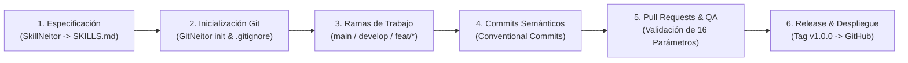

# 🛡️ Gestión Trabajo Papá (`Gestion-Papa`)


-003B57?logo=sqlite&logoColor=white)


> **Sistema Web Progresivo (PWA) para la gestión y programación de turnos de vigilancia privada (día, noche, relevos), cálculo automático de descansos compensatorios/festivos y control histórico de vacaciones.**

🔗 **Repositorio Oficial:** [https://github.com/ANDREXZ-21/Gestion-Papa](https://github.com/ANDREXZ-21/Gestion-Papa)  
📄 **Especificación Técnica Base:** [`SKILLS.md`](./SKILLS.md) *(Generado con SkillNeitor)*  
📘 **Documento de Integración Metodológica:** [`INTEGRACION_SKILLNEITOR_GITNEITOR.md`](./INTEGRACION_SKILLNEITOR_GITNEITOR.md)

---

## 📋 Tabla de Contenidos

1. [Descripción del Proyecto](#-1-descripción-del-proyecto)
2. [Arquitectura y Stack Tecnológico](#-2-arquitectura-y-stack-tecnológico)
3. [Los 16 Parámetros de Diseño (SkillNeitor)](#-3-los-16-parámetros-de-diseño-definidos-con-skillneitor)
4. [Estructura del Proyecto](#-4-estructura-del-proyecto)
5. [Guía de Instalación, Ejecución y Uso](#-5-guía-de-instalación-ejecución-y-uso)
6. [Ciclo de Vida y Flujo de Trabajo en GitHub con GitNeitor](#-6-ciclo-de-vida-y-flujo-de-trabajo-en-github-con-gitneitor)
7. [Pruebas, Respaldos y Despliegue](#-7-pruebas-respaldos-y-despliegue)

---

## 📌 1. Descripción del Proyecto

**Gestión Trabajo Papá** es una aplicación web progresiva (**PWA**) diseñada específicamente para guardas de seguridad privada y supervisores operativos. Permite llevar un registro riguroso, rápido y accesible desde dispositivos móviles o escritorio de la programación de turnos laborales (**12h diurno, 12h nocturno, relevos, permisos e incapacidades**), automatizando el conteo de días trabajados frente a los **descansos reglamentarios y compensatorios acumulados** (incluyendo festivos y dominicales en Colombia), así como el control detallado de los **periodos de vacaciones causados, programados y disfrutados**.

### Alcance Funcional
- **Gestión de Turnos Operativos:** Soporte para patrones de rotación estándar en vigilancia (`2x2x2`, `6x1`, `4x2`, `diurno_fijo`, `nocturno_fijo`), asignación de puestos de guardia y registro de minutas/relevos.
- **Motor de Cálculo de Compensatorios y Festivos:** Identificación automática de domingos y días festivos laborados (`src/shared/holidays.js`) que generan derecho a día compensatorio.
- **Control de Vacaciones:** Seguimiento de saldo de días hábiles pendientes, periodos históricos disfrutados y alertas de vencimiento.
- **Respaldo Local y Portabilidad:** Generación y restauración de copias de seguridad (`.sqlite` / JSON) mediante interfaz web y CLI (`npm run backup`).
- **Mesa de Ayuda / Soporte Interno:** Módulo de tickets para reportar novedades de nómina/turnos o dudas sobre periodos de vacaciones.

---

## 🏗️ 2. Arquitectura y Stack Tecnológico

El sistema implementa una arquitectura de **Monolito Modular** con enfoque *Zero-External-Dependencies* en tiempo de ejecución, apoyándose exclusivamente en las APIs nativas de **Node.js >= 22.0.0** para garantizar máxima velocidad, seguridad en la cadena de suministro y facilidad de despliegue local o en la nube.

| Capa | Tecnología / Estándar | Rol en la Aplicación |
| :--- | :--- | :--- |
| **Frontend (UI/UX)** | HTML5 Semántico, CSS3 Custom Properties, JS Vanilla (ES2023+) | Interfaz reactiva sin frameworks pesados, accesible (WCAG 2.2 AA) y diseño *Mobile-First*. |
| **Capacidades PWA** | `manifest.webmanifest` + Service Worker (`sw.js`) | Instalación en pantalla de inicio móvil/escritorio y soporte *offline-first* para consulta de turnos. |
| **Backend & API** | Node.js (`>= 22.0.0`) HTTP Server Nativo (`src/server.js`, `src/app.js`) | API RESTful JSON modularizada por dominios (`auth`, `turnos`, `vacaciones`, `backups`, `soporte`). |
| **Base de Datos** | SQLite Nativo (`node:sqlite` - `DatabaseSync`) | Persistencia relacional transaccional ACID en archivo local (`data/gestion_papa.sqlite`) con `PRAGMA foreign_keys = ON`. |
| **Seguridad** | `node:crypto` (Hashing de PIN, Tokens de Sesión, Headers HTTP) | Autenticación por rol (`guarda` / `supervisor`), sesiones con expiración TTL y validación estricta de esquemas. |
| **Testing & CLI** | `node --test` + Scripts nativos (`seed.js`, `cli-backup.js`) | Ejecución de pruebas automatizadas, carga de datos semilla y respaldos programables por consola. |
| **Gobernanza IA / DevOps** | **SkillNeitor 1.2.0** + **GitNeitor** | Definición de las especificaciones técnicas (16 parámetros clave) y automatización documental/versionado en GitHub. |

---

## 🎯 3. Los 16 Parámetros de Diseño (Definidos con SkillNeitor)

Previo a la codificación, se utilizó **SkillNeitor** para estructurar las reglas de ingeniería del proyecto (consolidadas en [`SKILLS.md`](./SKILLS.md)) a través de **4 dimensiones técnicas y 16 parámetros verificables** (4 por área):

### 3.1. Parámetros de Interfaz de Usuario (UI)
1. **Sistema de Tokens de Diseño (Design Tokens):** Uso de variables CSS (`--color-*`, `--spacing-*`, `--radius-*`) para mantener consistencia visual y jerarquía tipográfica clara.
2. **Contraste Visual y Legibilidad (WCAG 2.2 AA):** Relación de contraste mínima de `4.5:1` en texto normal y `3:1` en texto grande e indicadores semánticos (diferenciación visual por color + ícono/etiqueta para turnos Diurno, Nocturno, Descanso y Vacaciones).
3. **Diseño Responsivo y Adaptativo (*Mobile-First*):** Adaptación fluida en resoluciones de `320px`, `768px`, `1024px` y soporte de zoom hasta `200%` sin scroll horizontal involuntario.
4. **Objetivos Táctiles Ampliados (*Touch Targets*):** Botones y controles interactivos de mínimo `24x24 px` (optimizados a `44x44 px` en vista móvil) pensados para guardas de seguridad en campo.

### 3.2. Parámetros de Experiencia de Usuario (UX)
5. **Navegación por Teclado y Gestión de Foco:** Recorrido completo mediante `Tab`/`Shift+Tab`, foco visible (`:focus-visible`) y atrapamiento de foco en modales de registro.
6. **Validación de Formularios con Baja Fricción:** Etiquetas permanentes visibles, agrupación lógica de campos, validación contextual con mensajes de recuperación claros sin borrar los datos ingresados ante un error.
7. **Microcopy Claro y Estados Vacíos Accionables:** Lenguaje directo en español adaptado al contexto de vigilancia privada; cada listado vacío explica el estado actual y ofrece la acción principal recomendada.
8. **Soporte Progresivo (PWA) y Resiliencia:** Instalación directa en dispositivos móviles y almacenamiento en caché mediante Service Worker para consulta rápida incluso con conectividad inestable.

### 3.3. Parámetros de Base de Datos (BD)
9. **Integridad Referencial y Restricciones de Dominio (`CHECK` / `UNIQUE`):** Activación explícita de `PRAGMA foreign_keys = ON`, claves foráneas con `ON DELETE CASCADE` / `ON DELETE SET NULL` y validaciones `CHECK` a nivel de motor SQLite (formatos de fecha ISO `YYYY-MM-DD`, rangos de horas `0..24` y tipos de turno válidos).
10. **Control de Versiones de Esquema (`schema_migrations`) y Concurrencia:** Tabla de control de migraciones y columna `version` en registros críticos (`shifts`, `vacation_records`) para control de concurrencia optimista y auditoría (`created_at`, `updated_at`, `updated_by`).
11. **Indexación Estratégica por Patrón de Consulta:** Índices compuestos (`idx_shifts_user_date`, `idx_shifts_user_type`, `idx_vacations_user_start`, `idx_sessions_expires`) para acelerar filtros por calendario y resúmenes mensuales.
12. **Estrategia de Respaldo, Semillas y Recuperación:** Scripts transaccionales de inicialización (`src/shared/seed.js`) y módulo automatizado de copias de seguridad (`src/modules/backups` y `src/shared/cli-backup.js`).

### 3.4. Parámetros de Compilación, Ejecución y Entrega (Build & Runtime)
13. **Arquitectura *Zero-Build* / Ejecución Nativa en Node.js 22+:** Uso del runtime nativo (`node:http`, `node:sqlite`, `node:crypto`, `node:test`) eliminando pasos frágiles de transpilación y reduciendo la superficie de vulnerabilidades de paquetes de terceros (`npm audit` limpio).
14. **Configuración Basada en Variables de Entorno (`12-Factor App`):** Externalización de parámetros sensibles y de infraestructura (`PORT`, `HOST`, `DB_PATH`, `BACKUP_DIR`, `APP_SECRET`) mediante `.env` / `.env.example` centralizados en `src/shared/config.js`.
15. **Automatización de Scripts de Ciclo de Vida (`package.json`):** Estandarización de comandos de ejecución (`npm start`), desarrollo en caliente con observador nativo (`npm run dev` con `node --watch`), pruebas (`npm test`), semillas (`npm run seed`) y respaldos (`npm run backup`).
16. **Empaquetado Estático y Caché Determinista:** Entrega optimizada de recursos estáticos (`public/`) con control de versiones en Service Worker (`sw.js`) y cabeceras HTTP de seguridad (`src/shared/security.js`).

---

## 📂 4. Estructura del Proyecto

```text
Gestion-Papa/
├── public/                         # Capa Frontend (PWA Estática)
│   ├── index.html                  # Estructura HTML5 semántica y accesible
│   ├── styles.css                  # Sistema de diseño, variables CSS y responsive
│   ├── app.js                      # Lógica de cliente, consumo de API y estado UI
│   ├── manifest.webmanifest        # Manifiesto Web App Progresiva (PWA)
│   ├── sw.js                       # Service Worker para soporte offline y caché
│   └── icon.svg                    # Iconografía vectorial de la aplicación
├── src/                            # Capa Backend (Monolito Modular en Node.js 22+)
│   ├── server.js                   # Punto de entrada HTTP y manejo de cierre limpio
│   ├── app.js                      # Enrutador central, middlewares y servidor estático
│   ├── modules/                    # Módulos de dominio desacoplados
│   │   ├── auth/index.js           # Autenticación por PIN, sesiones y roles
│   │   ├── turnos/index.js         # CRUD de turnos, cálculo de dominicales/compensatorios
│   │   ├── vacaciones/index.js     # Gestión de periodos de vacaciones y saldos
│   │   ├── backups/index.js        # Generación y descarga de respaldos desde API
│   │   └── soporte/index.js        # Gestión de tickets y novedades operativas
│   └── shared/                     # Núcleo transversal compartido
│       ├── config.js               # Carga y validación de variables de entorno
│       ├── database.js             # Esquema SQLite, migraciones y conexión
│       ├── holidays.js             # Calendario y cálculo de festivos de Colombia
│       ├── logger.js               # Registro estructurado de eventos y errores
│       ├── security.js             # Hashing, tokens, sanitización y cabeceras HTTP
│       ├── seed.js                 # Datos iniciales de prueba (guardas, puestos, turnos)
│       └── cli-backup.js           # Utilidad CLI para copias de seguridad locales
├── .env.example                    # Plantilla de variables de entorno
├── .gitignore                      # Exclusión de artefactos, BD local y secretos
├── package.json                    # Manifiesto del proyecto y scripts de automatización
├── SKILLS.md                       # Especificación técnica generada con SkillNeitor
├── INTEGRACION_SKILLNEITOR_GITNEITOR.md # Documento técnico de relación SkillNeitor + GitNeitor
└── README.md                       # Documentación principal del repositorio (GitNeitor)
```

---

## 🚀 5. Guía de Instalación, Ejecución y Uso

### 5.1. Prerrequisitos
- **Node.js:** Versión `22.0.0` o superior (requerido por el módulo nativo `node:sqlite`).
- **Git:** Para clonación y control de versiones.

### 5.2. Instalación Paso a Paso

```bash
# 1. Clonar el repositorio oficial gestionado con GitNeitor
git clone https://github.com/ANDREXZ-21/Gestion-Papa.git
cd Gestion-Papa

# 2. Crear el archivo de variables de entorno a partir de la plantilla
cp .env.example .env

# 3. Poblar la base de datos SQLite con datos semilla iniciales (usuarios, puestos y turnos de ejemplo)
npm run seed

# 4. Iniciar el servidor en modo desarrollo (con recarga automática)
npm run dev
```

Para entornos de producción o ejecución estándar:
```bash
npm start
```

Una vez iniciado, abre en tu navegador: **`http://127.0.0.1:3000`**

---

## 🔄 6. Ciclo de Vida y Flujo de Trabajo en GitHub con GitNeitor

Todo el ciclo de vida del repositorio en GitHub ([`ANDREXZ-21/Gestion-Papa`](https://github.com/ANDREXZ-21/Gestion-Papa)) fue estructurado, versionado y documentado empleando **GitNeitor**, garantizando trazabilidad total desde los lineamientos de **SkillNeitor** hasta el código en producción.



### Fase 1: Inicialización y Gobernanza del Repositorio
Con **GitNeitor** se configuró la estructura base del repositorio local y su vinculación con el remoto en GitHub:
1. Inicialización del repositorio (`git init`) y definición de la rama principal `main`.
2. Configuración de `.gitignore` para proteger archivos sensibles (`.env`, bases de datos locales `data/*.sqlite`, `backups/`) y mantener el árbol de trabajo limpio.
3. Incorporación del archivo fundacional [`SKILLS.md`](./SKILLS.md) como primer artefacto auditable del repositorio.
4. Enlace con el servidor remoto:
   ```bash
   git remote add origin https://github.com/ANDREXZ-21/Gestion-Papa.git
   ```

### Fase 2: Estrategia de Ramificación (Branching Model)
GitNeitor establece un modelo de ramificación estructurado y ligero basado en **GitHub Flow / Feature Branching**:

| Rama | Propósito Técnico | Regla de Protección / Integración |
| :--- | :--- | :--- |
| `main` | Rama estable de producción. Contiene versiones probadas y listas para uso del guarda/supervisor. | Sólo recibe código validado con pruebas (`npm test`) y documentación actualizada. |
| `develop` | Rama de integración continua donde convergen los módulos (`auth`, `turnos`, `vacaciones`, `backups`, `soporte`). | Punto de partida para las ramas de funcionalidades. |
| `feat/<modulo>` | Desarrollo aislado de nuevas características (ej. `feat/turnos-compensatorios`, `feat/vacaciones-saldo`, `feat/pwa-offline`). | Se fusiona mediante *Pull Request* tras verificar los criterios de aceptación de `SKILLS.md`. |
| `fix/<incidencia>` | Corrección de errores puntuales en cálculo de festivos, validaciones UI o consultas SQLite. | Fusión rápida con pruebas de regresión asociadas. |
| `docs/<alcance>` | Actualización de documentación técnica (`README.md`, `SKILLS.md`, `INTEGRACION_SKILLNEITOR_GITNEITOR.md`). | Revisión de formato Markdown y trazabilidad con el código. |

### Fase 3: Convención de Commits (Conventional Commits con GitNeitor)
Para mantener un historial legible y auditable, GitNeitor aplica el estándar **Conventional Commits** (`<tipo>(<alcance>): <descripción breve>`):

- `feat(turnos): implementar cálculo automático de dominicales y compensatorios`
- `feat(vacaciones): agregar control de periodos disfrutados y días hábiles pendientes`
- `feat(ui): aplicar diseño responsive mobile-first y accesibilidad WCAG 2.2 AA`
- `feat(db): definir esquema SQLite con integridad referencial y control de versiones`
- `chore(build): configurar scripts nativos de Node.js 22 para seed, test y backup`
- `docs(gitneitor): documentar ciclo de vida e integración con SkillNeitor`

### Fase 4: Flujo de Pull Requests (PR) y Auditoría contra SkillNeitor
Cada integración gestionada mediante GitNeitor sigue una lista de verificación (*Checklist de PR*) alineada con los 16 parámetros de diseño:
1. **Verificación UI/UX:** ¿La vista cumple con el contraste AA, navegación por teclado y adaptación a `320px`?
2. **Verificación de Base de Datos:** ¿Las consultas usan parámetros preparados (`?`) y respetan las restricciones `CHECK`/`FOREIGN KEY` en `database.js`?
3. **Verificación de Compilación/Ejecución:** ¿El servidor inicia sin errores (`npm start`) y las pruebas automatizadas pasan (`npm test`)?
4. **Sincronización Remota:** Publicación hacia GitHub (`git push -u origin main`).

### Fase 5: Versionado Semántico (SemVer) y Releases
El proyecto sigue **Semantic Versioning (`MAJOR.MINOR.PATCH`)**:
- **`v0.1.0`:** Estructura base del monolito modular, conexión `node:sqlite` y semilla inicial (`SKILLS.md` integrado).
- **`v0.5.0`:** Módulos completos de `auth`, `turnos`, `vacaciones`, `soporte` y `backups`.
- **`v1.0.0` (Release Actual):** Interfaz PWA completa (`manifest.webmanifest`, `sw.js`), validaciones WCAG 2.2 AA, respaldos CLI y documentación técnica integral con **GitNeitor**.

---

## 🧪 7. Pruebas, Respaldos y Despliegue

### Comandos Disponibles en `package.json`

| Comando | Script Ejecutado | Descripción Técnica |
| :--- | :--- | :--- |
| `npm start` | `node src/server.js` | Inicia el servidor HTTP en modo estándar (`PORT=3000` por defecto). |
| `npm run dev` | `node --watch src/server.js` | Inicia el servidor con observador nativo de archivos para desarrollo ágil. |
| `npm test` | `node --test tests/*.test.js` | Ejecuta la suite de pruebas nativas de Node.js sin librerías externas. |
| `npm run seed` | `node src/shared/seed.js` | Inicializa el esquema SQLite e inserta usuarios, puestos y turnos de prueba. |
| `npm run backup` | `node src/shared/cli-backup.js` | Genera una copia de seguridad inmediata de la base de datos en `/backups`. |

---

## 📄 Licencia y Autoría

- **Proyecto:** Gestión Trabajo Papá (`gestion-trabajo-papa`)
- **Repositorio GitHub:** [https://github.com/ANDREXZ-21/Gestion-Papa](https://github.com/ANDREXZ-21/Gestion-Papa)
- **Metodología de Ingeniería:** Especificación con **SkillNeitor** + Gestión de Repositorio y Documentación con **GitNeitor**.
- **Licencia:** Distribuido bajo la licencia **MIT**.
